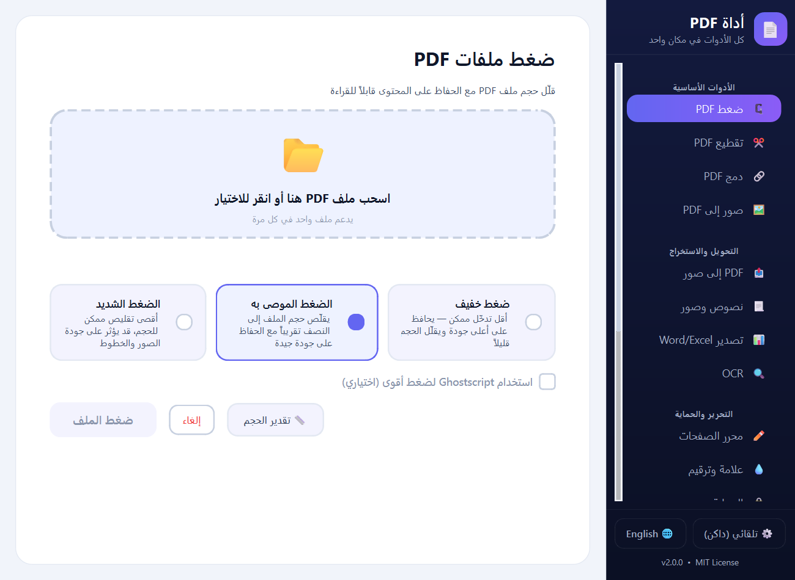
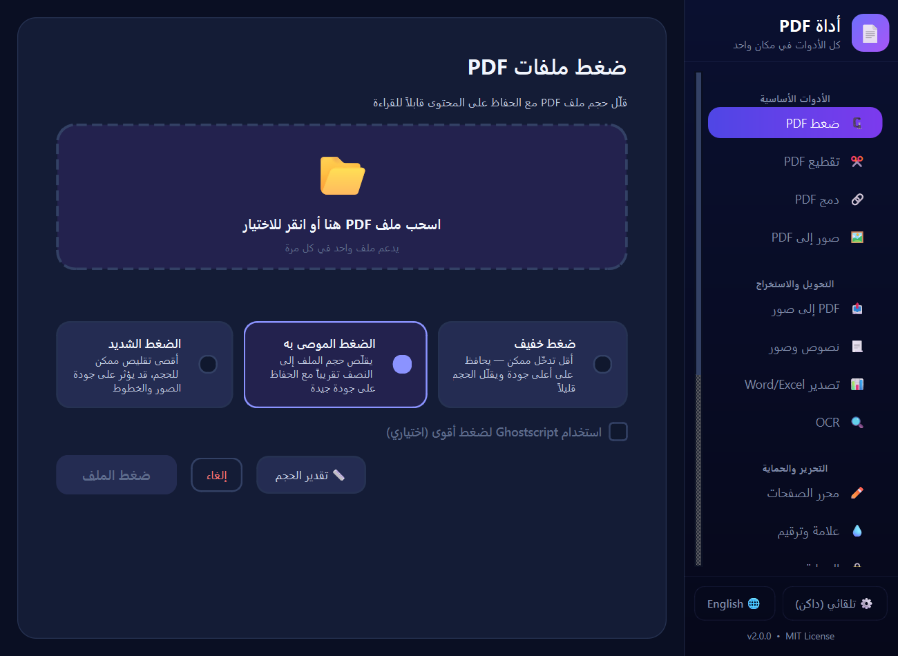
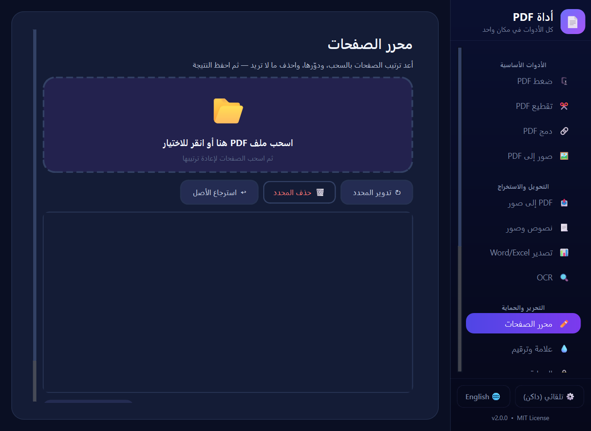
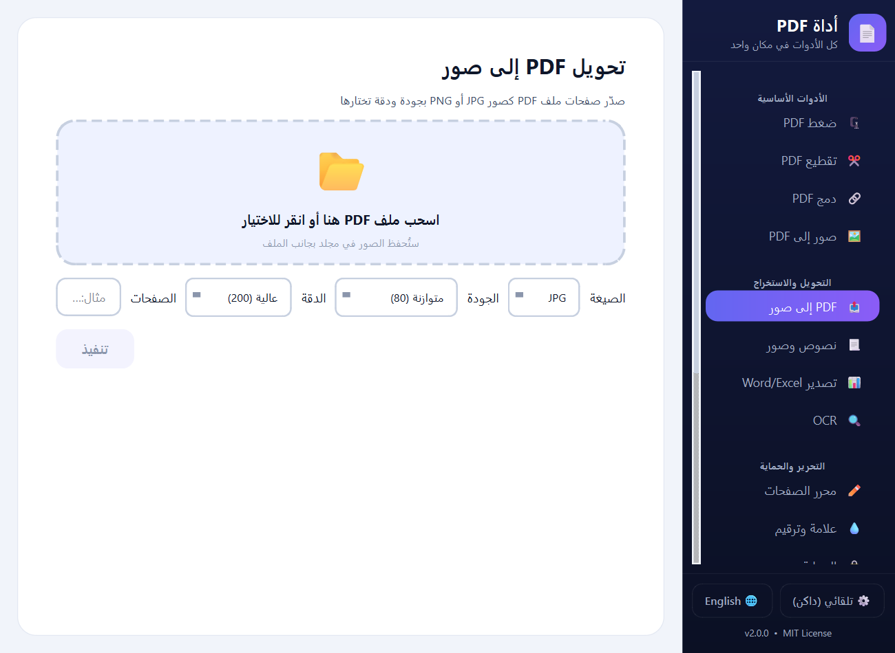
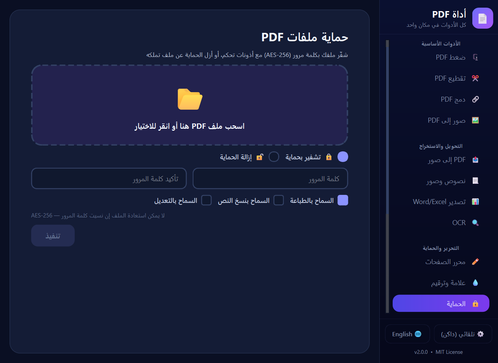

# 📄 PDF Toolbox — أداة PDF

تطبيق سطح مكتب عربي شامل لمعالجة ملفات PDF: **17 أداة** في نافذة واحدة — ضغط، تقطيع بالفصول، دمج، تحويل بالاتجاهين، استخراج نصوص وصور، محرر صفحات بالسحب، علامة مائية وترقيم، حماية AES-256، إصلاح الملفات التالفة، OCR عربي، مقارنة نسختين، مساعد ذكي، وفك ضغط الأرشيفات.


## 🖼️ لقطات الشاشة

| | |
|---|---|
|  |  |
|  |  |
|  |  |

> كل لقطات الواجهة في مجلد [docs/screenshots](docs/screenshots) — 17 لقطة تغطي كل الأدوات في الوضعين الفاتح والداكن.

## ✨ الأدوات (17)

### الأدوات الأساسية
| الأداة | الوصف |
|--------|-------|
| 🗜️ **ضغط PDF** | 3 مستويات (خفيف/موصى به/شديد) + 📏 تقدير الحجم قبل الحفظ + رسم مقارن خفيف بـ QPainter |
| ✂️ **تقطيع PDF** | نطاقات يدوية، نقرة على المعاينة، كل صفحة ملف، أو **📚 تقسيم حسب الفهرس (الفصول)** |
| 🔗 **دمج PDF** | عدة ملفات في واحد مع إعادة الترتيب بالسحب |
| 🖼️ **صور إلى PDF** | JPG/PNG/BMP/WEBP → PDF بترتيب قابل للتعديل |

### التحويل والاستخراج
| الأداة | الوصف |
|--------|-------|
| 📤 **PDF إلى صور** | JPG/PNG بجودة ودقة وصفحات مختارة (PyMuPDF) |
| 📃 **نصوص وصور** | استخراج نص الملف كاملاً إلى txt (UTF-8) أو كل الصور المضمّنة بجودتها الأصلية |
| 📊 **تصدير Word/Excel** | DOCX عبر pdf2docx وجداول XLSX عبر pdfplumber |
| 🔍 **OCR** | الممسوح ضوئياً ← PDF قابل للبحث (Tesseract، عربي+إنجليزي) |

### التحرير والحماية
| الأداة | الوصف |
|--------|-------|
| ✏️ **محرر الصفحات** | إعادة ترتيب بالسحب والإفلات، تدوير 90°، حذف، ثم حفظ |
| 💧 **علامة وترقيم** | علامة مائية نصية (عربية ✓) أو صورة، بشفافية وزاوية وحجم ولون، + ترقيم تلقائي (صفحة X من Y) |
| 🔒 **الحماية** | تشفير **AES-256** (pikepdf R=6) مع أذونات طباعة/نسخ/تعديل، أو إزالة الحماية بكلمة المرور |
| 🩺 **إصلاح** | إنقاذ الملفات التالفة: pikepdf أولاً ثم PyMuPDF كاحتياط |

### أدوات إضافية
| الأداة | الوصف |
|--------|-------|
| ⚖️ **مقارنة PDF** | فروقات نصية ملوّنة بين نسختين |
| 🤖 **مساعد ذكي** | تلخيص وأسئلة محلياً عبر Ollama أو API اختياري |
| 📦 **فك ضغط الأرشيفات** | ZIP/TAR/7z/RAR مع حماية Zip-Slip وإصلاح أسماء الملفات العربية المشوهة |

## 🆕 ما الجديد في v2.0.0

- **9 أدوات متجددة**: PDF→صور، استخراج نصوص وصور، محرر صفحات، علامة مائية وترقيم، حماية AES-256، إصلاح، مقارنة، مساعد ذكي، تصدير — بواجهات موحّدة مع نظام الأدوات الجديد.
- **🌐 واجهة ثنائية اللغة** — عربي/إنجليزي عبر زر 🌐 في التذييل (إعادة تشغيل واحدة، اتجاه LTR للإنجليزية). الشريط الجانبي والتبويبات الجديدة مترجمة بالكامل.
- **⌨️ لوحة انتقال سريع Ctrl+K** + اختصارات `Ctrl+1..0` للأدوات العشرة الأولى.
- **🔔 فاحص تحديث GitHub** — فحص هادئ عند الإقلاع، أو يدوياً بـ `F5` أو زر في تبويب معلومات.
- **🕘 سجل نشاط** — عدد الملفات المعالجة والمساحة الموفّرة وآخر 8 عمليات (محلياً في `settings.json`).
- **📏 تقدير الحجم قبل الضغط** + مستوى ضغط رابع **"خفيف"** يحافظ على الجودة القصوى.
- **📚 تقسيم حسب الفهرس** — يقسّم الملف إلى ملفات حسب فصوله تلقائياً.
- **⌨️ واجهة سطر أوامر (CLI)** — كل العمليات من الطرفية دون فتح النافذة.
- **🩺 سجل أخطاء محلي** — `logs/app.log` مع نافذة ودّية عند أي خطأ غير متوقع (فتح السجل / إبلاغ المطور).
- **📦 مثبّت ويندوز** — سكربت Inno Setup جاهز في `installer/`.
- **⚙️ بناء تلقائي** — GitHub Actions يبني الـ exe عند كل وسم `v*` ويرفقه للإصدار.

## ⌨️ سطر الأوامر (CLI)

كل الأدوات متاحة من الطرفية — التشغيل مع أي وسيط ينفّذ العملية مباشرة:

```bash
# ضغط (مستويات: light / recommended / extreme)
python main.py compress input.pdf -o out.pdf --level recommended

# دمج عدة ملفات
python main.py merge a.pdf b.pdf c.pdf -o merged.pdf

# تقطيع: نطاقات / كل صفحة / حسب الفهرس
python main.py split input.pdf --pages "1-3,5"
python main.py split input.pdf --each
python main.py split input.pdf --bookmarks

# صور إلى PDF و PDF إلى صور
python main.py convert *.jpg -o out.pdf
python main.py pdf2img input.pdf --fmt png --dpi 200

# حماية / إزالة حماية
python main.py protect input.pdf --password "1234" --allow-copy
python main.py protect input.pdf --password "1234" --remove

# علامة مائية وترقيم
python main.py stamp input.pdf --watermark "نسخة غير رسمية" --number page_of_ar

# استخراج نص/صور، وإصلاح
python main.py extract input.pdf --text
python main.py extract input.pdf --images
python main.py repair broken.pdf -o fixed.pdf
```

## 🎨 التصميم والتجربة

- واجهة عربية كاملة (RTL) بنظام تصميم موحّد (`ui/styles.py`) — شريط جانبي بأقسام منظم
- ثلاثة أوضاع: تلقائي (يتبع النظام) / داكن 🌙 / فاتح ☀️ — يُحفظ الاختيار
- منطقة سحب وإفلات لكل الأدوات، وعمليات غير متزامنة لا تُجمّد الواجهة
- إشعارات Toast، تمرير داخلي، وشريط تذييل: الثيم + اللغة + الإصدار

## 📥 تحميل

حمّل أحدث نسخة من صفحة [Releases](../../releases) — ملف exe مستقل للويندوز (لا يحتاج تثبيتاً)، أو مثبّت `PDF_Toolbox_Setup` عبر Inno Setup.

## 🚀 التشغيل من المصدر

```bash
pip install -r requirements.txt
python main.py          # الواجهة الرسومية
python main.py --help   # مساعدة سطر الأوامر
```

> **ملاحظات تشغيل:**
> - **OCR:** يتطلب [Tesseract OCR](https://github.com/UB-Mannheim/tesseract/wiki) مع حزمتي `ara` و`eng` + مكتبة `pytesseract`.
> - **المساعد الذكي:** يتطلب [Ollama](https://ollama.com/) محلياً (مثل `ollama run llama3.2`) أو مفتاح API اختياري.
> - **اللغة:** يغطي المترجم الشريط الجانبي والتبويبات الجديدة ومعلومات/المطور؛ التبويبات الأربعة الأصلية (ضغط/تقطيع/دمج/صور) تبقى عربية.

## 📦 بناء الـ exe

```bash
# ملف واحد مستقل (≈125 MB)
python -m PyInstaller PDF_Toolbox.spec --noconfirm --clean

# أو مثبّت ويندوز (يتطلب Inno Setup 6)
ISCC.exe installer\PDF_Toolbox.iss
# الناتج: dist/installer/PDF_Toolbox_Setup_v2.0.0.exe
```

## 🏗️ البنية

```
pdf_toolbox/
├── main.py                 # نقطة الدخول + واجهة سطر الأوامر
├── version.py              # معلومات الإصدار المركزية
├── core/                   # منطق المعالجة (بلا اعتماد على الواجهة)
│   ├── compress.py         # الضغط (PyMuPDF / Ghostscript / pikepdf) + تقدير الحجم
│   ├── split.py            # تقطيع (pypdf) + حسب الفهرس (PyMuPDF)
│   ├── merge.py            # دمج (pypdf)
│   ├── convert.py          # صور → PDF (img2pdf)
│   ├── pdf2img.py          # PDF → صور (PyMuPDF)
│   ├── extract.py          # استخراج نصوص وصور
│   ├── pages.py            # محرر الصفحات (إعادة ترتيب/تدوير)
│   ├── stamp.py            # علامة مائية عربية + ترقيم (insert_htmlbox)
│   ├── protect.py          # تشفير AES-256 وإزالته (pikepdf)
│   ├── repair.py           # إصلاح الملفات التالفة
│   ├── ocr.py              # التعرف الضوئي (Tesseract، اختياري)
│   ├── export.py           # تصدير Word/Excel
│   ├── pdf_diff.py         # مقارنة ملفين
│   ├── ai_assistant.py     # المساعد الذكي (Ollama / API)
│   ├── archive_extract.py  # فك ضغط الأرشيفات
│   ├── history.py          # سجل النشاط والإحصائيات
│   └── logger.py           # سجل أخطاء متناوب + معالج استثناءات
├── ui/                     # واجهة PySide6
│   ├── main_window.py      # النافذة الرئيسية (أقسام، اختصارات، لغة، تحديث)
│   ├── *_tab.py            # 17 تبويب أداة
│   ├── i18n.py             # ترجمة عربي/إنجليزي
│   ├── palette.py          # لوحة Ctrl+K
│   ├── update_checker.py   # فاحص تحديث GitHub
│   ├── widgets.py          # DropZone, FileList, Worker + إلغاء
│   ├── toast.py            # إشعارات عائمة
│   └── styles.py           # نظام التصميم (فاتح/داكن/تلقائي)
├── installer/              # سكربت Inno Setup
├── docs/screenshots/       # لقطات الواجهة (فاتح/داكن)
├── .github/workflows/      # بناء تلقائي للإصدارات
├── resources/              # الأيقونات
├── requirements.txt
└── PDF_Toolbox.spec        # إعداد PyInstaller (ملف مستقل onefile)
```

## 📚 المكتبات المستخدمة

- **PySide6** — إطار الواجهة (Qt) + QSS + QPainter
- **PyMuPDF (fitz)** — ضغط، علامة مائية عربية، ترقيم، معاينات، PDF→صور، فهرس
- **pypdf** — تقطيع ودمج
- **img2pdf** — صور → PDF
- **Pillow (PIL)** — معالجة الصور
- **pikepdf** — تشفير AES-256 وإصلاح الملفات
- **py7zr / rarfile** — أرشيفات 7z وRAR (اختيارية)
- **pdf2docx / pdfplumber / openpyxl** — تصدير Word/Excel
- **pytesseract** — OCR (اختياري، يتطلب Tesseract)

## 📄 الترخيص

MIT License
