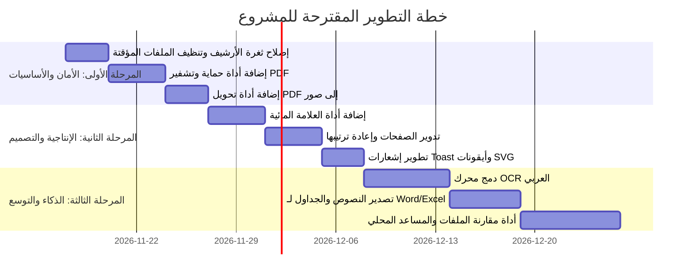

# 📄 نظام PDF Toolbox — التحليل الشامل وخارطة طريق التطوير
> **دليل استراتيجي وتقني شامل لتحليل النظام والارتقاء به ليتفوق على أشهر تطبيقات الـ PDF عالمياً.**

---

## 📑 الفهرس
1. [ملخص تنفيذي ونقاط القوة الحالية](#-1-ملخص-تنفيذي-ونقاط-القوة-الحالية)
2. [التحليل التقني وفحص الشيفرة البرمجية (نقاط الضعف والثغرات)](#-2-التحليل-التقني-وفحص-الشيفرة-البرمجية)
3. [ترتيب المزايا والخدمات المقترحة حسب القيمة والأثر](#-3-ترتيب-المزايا-والخدمات-المقترحة-حسب-القيمة)
4. [أفكار إبداعية لم تُطرح مسبقاً (Game Changers)](#-4-أفكار-إبداعية-لم-تُطرح-مسبقاً)
5. [الارتقاء بالجاذبية البصرية وتجربة المستخدم (UI/UX)](#-5-الارتقاء-بالجاذبية-البصرية-وتجربة-المستخدم)
6. [مقارنة تنافسية مع كبرى التطبيقات في السوق](#-6-مقارنة-تنافسية-مع-كبرى-التطبيقات)
7. [خطة العمل التنفيذية المرحلية](#-7-خطة-العمل-التنفيذية-المرحلية)

---

## 🌟 1. ملخص تنفيذي ونقاط القوة الحالية

يتميز **PDF Toolbox** ببنية معمارية واعدة ونظيفة تفصل بشكل ممتاز بين منطق المعالجة الأساسي (`core/`) وواجهة المستخدم الرسومية (`ui/`).

### أبرز نقاط القوة التنافسية:
1. **الخصوصية التامة (100% Offline):** جميع العمليات تتم محلياً دون رفع أي بايت إلى خوادم خارجية، وهو ما يعالج الهاجس الأكبر لدى الشركات والأفراد تجاه خدمات السحابة مثل SmallPDF و iLovePDF.
2. **واجهة عربية أصيلة (RTL Native):** تصميم مبني لدعم اللغة العربية وتدفق الاتجاه من اليمين إلى اليسار من الصفر، وليس مجرد تعريب لاحق.
3. **محرك ضغط هجين ذكي:** يعتمد على مسار متدرج يبدأ بـ `PyMuPDF` (لإعادة ترميز الصور مع الحفاظ على النصوص البرمجية) ثم `Ghostscript` للضغط الأقصى، مع حماية بديلة عبر `pikepdf`.
4. **تعدد المهام وتجاوب الواجهة:** استخدام خيوط منفصلة (`QThread / Worker`) يحمي الواجهة من التجمد والتعليق أثناء معالجة الملفات الكبيرة.
5. **نظام تصميم عصري موحد:** تميز في دعم الثيم الداكن والفاتح والتلقائي مع ألوان متدرجة مدروسة واقتباس نمط البطاقات الحديثة.

---

## 🔍 2. التحليل التقني وفحص الشيفرة البرمجية

من خلال الفحص الدقيق لكامل ملفات النظام، تم رصد مجموعة من الملاحظات التقنية والثغرات التي يجب معالجتها لضمان استقرار وأمان التطبيق:

| المكون / الملف | المشكلة المرصودة | درجة الأهمية | الحل التقني المقترح |
| :--- | :--- | :---: | :--- |
| `core/archive_extract.py` | **ثغرة أمنية (Zip-Slip في 7z):** يتم استدعاء `z.extractall(dest)` لملفات `7z` دون فحص المسارات الداخلية كما جرى مع ملفات `zip` و `tar`. | 🔴 حرجة | تفكيك عناصر الأرشيف وفحص كل مسار عبر `_safe_join` و `_is_within` قبل كتابته. |
| `core/convert.py` | **تراكم الملفات المؤقتة:** الصور الناتجة عن عملية المعالجة (`_norm.jpg`) في مجلد `tmp_dir` لا يتم حذفها بعد اكتمال إنشاء الـ PDF. | 🟡 متوسطة | استخدام `tempfile.TemporaryDirectory()` في كتلة `with` لضمان الحذف التلقائي فور الانتهاء. |
| `core/compress.py` | **ابتلاع الأخطاء بصمت:** عند فشل `Ghostscript` أو `PyMuPDF` يتم الانتقال للبديل عبر `pass` دون تسجيل سبب الفشل للمطور أو تنبيه المستخدم. | 🟡 متوسطة | إضافة نظام سجلات (`logging`) لمعرفة المحرك الذي نجح والمحرك الذي تعثر وأسباب التعثر. |
| `ui/widgets.py` | **غياب زر الإلغاء (Cancellation):** فئة `Worker` تنفذ الدالة ككتلة واحدة دون إمكانية إيقاف العملية إذا استغرقت وقتاً طويلاً. | 🟡 متوسطة | تزويد الدوال الحسابية بعلم إلغاء (`cancellation_token`) والتحقق الدوري منه داخل الحلقات. |
| `ui/compress_tab.py` | **حجم مكتبة `matplotlib` الكبير:** تستخدم لرسم شريطين أفقيين فقط، بينما تكلف التطبيق أكثر من 30MB في ملف الـ EXE وتبطئ الإقلاع. | 🟢 تحسين | استبدالها برسم مباشر وأخف عبر `QPainter` أو استخدام مكونات أشرطة تقدم مخصصة عالية الأناقة. |
| `ui/gender_dialog.py` | **كود غير مستخدم (Dead Code):** هذا الملف غير مستدعى أو مربوط بأي نافذة في التطبيق الحالي. | 🟢 تنظيف | إزالته لتخفيف المشروع وتجنب تشتيت الكود المصدري. |

---

## 🏆 3. ترتيب المزايا والخدمات المقترحة حسب القيمة

تم ترتيب هذه الخدمات بناءً على: **(حاجة السوق + سهولة التنفيذ التقني + العائد على تجربة المستخدم)**:

```
[المستوى 1: خدمات حاسمة]  🔐 التشفير والحماية ──> 💧 العلامة المائية ──> 📄 تحويل PDF لصور ──> 🔍 OCR عربي ──> 📥 المعالجة الجماعية
                                                                                │
[المستوى 2: أدوات إنتاجية] 🔄 تدوير وحذف الصفحات ──> 📑 إعادة ترتيب الصفحات ──> 📊 استخراج النصوص والجداول ──> 📝 التوقيع والتعليقات
```

---

### 🥇 المستوى الأول: خدمات حاسمة (لا غنى عنها في أي تطبيق PDF رائد)

#### 1. 🔐 حماية وتشفير ملفات PDF وإلغاء الحماية (Protect & Unlock)
* **الأهمية والقيمة:** ⭐⭐⭐⭐⭐ (المرتبة الأولى من حيث طلب الشركات والمؤسسات والأفراد).
* **الوصف:** تشفير المستند بخوارزمية AES-256 مع تعيين كلمة مرور لفتح الملف، وتقييد الصلاحيات (منع النسخ، منع الطباعة، أو منع التعديل)، مع أداة لإلغاء الحماية عند إدخال كلمة السر.
* **كيفية التنفيذ:** مكتبة `pikepdf` الموجودة بالفعل ضمن متطلبات مشروعك تدعم ذلك بكفاءة عالية وبأقل استهلاك للموارد.

#### 2. 💧 إضافة العلامة المائية (Watermark)
* **الأهمية والقيمة:** ⭐⭐⭐⭐⭐
* **الوصف:** وضع ختم نصي (مثل: "سري للغاية"، "نسخة مسودة"، "خاص") أو شعار/صورة للشركة، مع تحكم دقيق بزاوية الميلان، الشفافية، الحجم، واختيار تطبيقها على كل الصفحات أو صفحات محددة.
* **كيفية التنفيذ:** عبر فئة `fitz.TextWriter` في `PyMuPDF` التي تتيح دمج النصوص والصور بشفافية ودقة فائقة.

#### 3. 📄 تحويل صفحات PDF إلى صور (PDF to Images)
* **الأهمية والقيمة:** ⭐⭐⭐⭐½
* **الوصف:** ميزة مفقودة ومكملة للميزة الموجودة حالياً (صور إلى PDF). يحتاجها المستخدم لمشاركة صفحات معينة كصور PNG/JPG عالية الدقة على منصات التواصل وبرامج المراسلة.
* **كيفية التنفيذ:** استدعاء مباشر لـ `page.get_pixmap(dpi=150)` في `PyMuPDF` وتصدير الصفحات فوراً.

#### 4. 🔍 التعرف الضوئي على الحروف باللغة العربية (OCR)
* **الأهمية والقيمة:** ⭐⭐⭐⭐⭐ (أكبر ميزة تنافسية تميز التطبيق عن المنافسين)
* **الوصف:** تحويل المستندات الممسوحة ضوئياً (Scanned PDFs) والكتب القديمة إلى ملفات PDF قابلة للبحث ونسخ النصوص مع دعم قوي للحروف العربية.
* **كيفية التنفيذ:** دمج محرك `Tesseract OCR` مفتوح المصدر بتدريب الحزمة العربية (`ara`) وتحويل الصفحات إلى نصوص مع فهرسة طبقة النص غير المرئية فوق الصورة الأصلية.

#### 5. 📥 المعالجة الجماعية المجمعة (Batch Processing)
* **الأهمية والقيمة:** ⭐⭐⭐⭐½
* **الوصف:** تحويل أدوات الضغط، التحويل، والحماية لتقبل 20 أو 50 ملفاً دفعة واحدة بدلاً من إجبار المستخدم على معالجة كل ملف على حدة.
* **كيفية التنفيذ:** ترقية قوائم الملفات لتدعم المعالجة التسلسلية مع شريط تقدم إجمالي وشريط تقدم لكل ملف.

---

### 🥈 المستوى الثاني: أدوات إنتاجية متقدمة

#### 6. 🔄 تدوير وحذف الصفحات (Page Rotate & Delete)
* **الأهمية والقيمة:** ⭐⭐⭐⭐
* **الوصف:** تصحيح اتجاه الصفحات المقلوبة بمقدار 90° أو 180° بنقرة واحدة، وحذف صفحات زائدة مباشرة من شاشة العرض.
* **كيفية التنفيذ:** دمج أزرار تدوير وحذف بجانب كل بطاقة صفحة في شبكة المعاينة الحالية (`split_tab.py`).

#### 7. 📑 إعادة تنظيم وترتيب الصفحات بالسحب (Page Organizer)
* **الأهمية والقيمة:** ⭐⭐⭐⭐
* **الوصف:** واجهة بصرية تسمح للمستخدم بسحب بطاقات الصفحات وإعادة ترتيبها داخل المستند ثم إعادة حفظه بالترتيب الجديد.
* **كيفية التنفيذ:** تحويل `PageGrid` ليدعم خاصية السحب والإفلات الداخلي (`Drag and Drop Reordering`).

#### 8. 📊 استخراج النصوص والجداول (PDF to Word / Excel)
* **الأهمية والقيمة:** ⭐⭐⭐⭐
* **الوصف:** استخلاص النصوص من ملفات الـ PDF وتصديرها بصيغة Word (`.docx`)، أو اكتشاف الجداول وتصديرها إلى جداول بيانات (`.xlsx`).
* **كيفية التنفيذ:** استخدام مكتبات متخصصة مثل `pdf2docx` و `pdfplumber`.

#### 9. 📝 التوقيع الإلكتروني والتعليقات (Sign & Annotate)
* **الأهمية والقيمة:** ⭐⭐⭐⭐
* **الوصف:** إضافة توقيع يدوي (بالرسم عبر الماوس أو رفع صورة التوقيع)، مع أدوات تظليل النصوص (Highlight) وإضافة ملاحظات لاصقة.

---

## 💡 4. أفكار إبداعية لم تُطرح مسبقاً

ميزات فريدة تمنح البرنامج قصب السبق وتجذب المستخدمين المتمرسين:

### 1. 🤖 المساعد الذكي المحلي للمستندات (Local Privacy-First AI Assistant)
* **الفكرة:** دمج مساعد ذكاء اصطناعي يقوم بتلخيص المستند، استخراج أهم بنود العقود، أو الإجابة عن أي سؤال حول محتوى الملف.
* **نقطة القوة:** العمل **محلياً بالكامل** عبر نماذج خفيفة (مثل Ollama أو Llama.cpp) للحفاظ على سرية المستندات، مع إتاحة خيار للمستخدم لإدخال مفتاح API سحابي اختياري لمن يرغب بسرعة أعلى.

### 2. 🔍 أداة مقارنة نسختين من PDF (PDF Diff Visualizer)
* **الفكرة:** رفع نسختين من عقد أو تقرير وعرض الفروقات بدقة متناهية (تلوين الكلمات المحذوفة باللون الأحمر، والمضافة باللون الأخضر).
* **نقطة القوة:** ميزة نادرة جداً في البرمجيات المجانية وتستهدف فئة واسعة من المحامين والمدققين والمحاسبين.

### 3. ⚡ قوالب الأتمتة المخصصة (One-Click Workflows)
* **الفكرة:** تمكين المستخدم من إنشاء مسار عمل متكامل وتشغيله بضغطة زر واحدة.
* **مثال:** مسار "تجهيز العقود": (ضغط الملف 60% ⬅️ إضافة علامة مائية "معتمد" ⬅️ قفل الملف بكلمة مرور ⬅️ حفظه في مجلد محدد).

### 4. 🧹 فاحص ومنظف البيانات الوصفية (Metadata Stripper & Inspector)
* **الفكرة:** عرض البيانات المخفية داخل الملف (اسم صانع الملف، البرنامج المستخدم، الموقع الجغرافي، تاريخ الإنشاء والتعديل) وإتاحة زر "تنظيف شامل" لحذف كل الآثار الحساسة قبل إرسال الملف.

---

## 🎨 5. الارتقاء بالجاذبية البصرية وتجربة المستخدم (UI/UX)

لتحويل النظام من تطبيق وظيفي إلى منتج فخم يضاهي برمجيات أنظمة macOS وويندوز الحديثة:

1. **التحول إلى أيقونات متجهة (SVG Icons):**
   * استبدال الرموز التعبيرية (Emojis مثل 📄, ✂️, 🗜️) بحزمة أيقونات متجهة عالية الدقة والوضوح (مثل حزمة Lucide أو Tabler)، مما يمنح التطبيق مظهراً تجارياً موحداً على كافة الشاشات.
2. **نظام الإشعارات العائمة (Toast Notifications):**
   * الاستغناء عن نوافذ التنبيه التقليدية (`QMessageBox`) المعطلة للتدفق، واستبدالها بإشعارات ناعمة تظهر لثوانٍ في زاوية الشاشة وتختفي تلقائياً بتأثير انسيابي عند نجاح العمليات.
3. **الانتقالات الانسيابية (Smooth Micro-Interactions):**
   * تطبيق تأثير تلاشي ناعم (`QPropertyAnimation - Fade Transition`) عند التنقل بين أقسام الشريط الجانبي لتفادي التبديل اللحظي الحاد.
4. **عارض PDF تفاعلي مدمج (Built-in PDF Viewer):**
   * بدلاً من مطالبة المستخدم بالذهاب لفتح الملف بعد التعديل في قارئ خارجي، توفير نافذة عرض مسبق تفاعلية داخل التطبيق لعرض النتيجة فوراً والتكبير والتصغير.

---

## 📊 6. مقارنة تنافسية مع كبرى التطبيقات

| الخاصية / المعيار | PDF Toolbox (المستهدف) | SmallPDF | iLovePDF | Adobe Acrobat Pro | Foxit PDF Editor |
| :--- | :---: | :---: | :---: | :---: | :---: |
| **الخصوصية وعدم رفع الملفات** | ✅ محلي 100% | ❌ رفع سحابي | ❌ رفع سحابي | ✅ محلي / سحابي | ✅ محلي |
| **دعم العربية الأصيل (RTL)** | ✅ كامل ومدروس | ⚠️ واجهة مترجمة | ⚠️ واجهة مترجمة | ✅ جيد | ✅ جيد |
| **الضغط والتقطيع والدمج** | ✅ متوفر | ✅ متوفر | ✅ متوفر | ✅ متوفر | ✅ متوفر |
| **فك ضغط الأرشيفات في نفس التطبيق** | ✅ مدمج | ❌ غير متوفر | ❌ غير متوفر | ❌ غير متوفر | ❌ غير متوفر |
| **التعرف الضوئي على النصوص (OCR)** | ✅ مجاني | 🔒 اشتراك مدفوع | 🔒 اشتراك مدفوع | 🔒 اشتراك مدفوع | 🔒 اشتراك مدفوع |
| **حماية وتشفير المستندات** | ✅ مجاني | 🔒 اشتراك مدفوع | 🔒 اشتراك مدفوع | 🔒 اشتراك مدفوع | 🔒 اشتراك مدفوع |
| **نموذج التسعير** | **مجاني ومفتوح المصدر** | \$108 / سنوياً | \$84 / سنوياً | \$299 / سنوياً | \$159 / سنوياً |

---

## 📅 7. خطة العمل التنفيذية المرحلية



---

> 💡 **خلاصة:** إن الجمع بين **الخصوصية المحلية الكاملة** و**الواجهة العربية المتقنة** وتوفير **الميزات المحتكرة لدى المواقع المدفوعة (كالـ OCR والتشفير والعلامة المائية)** مجاناً في تطبيق سطح مكتب خفيف ومتقن، سيجعل **PDF Toolbox** الأداة العربية رقم 1 بلا منازع في معالجة المستندات الرقمية.
